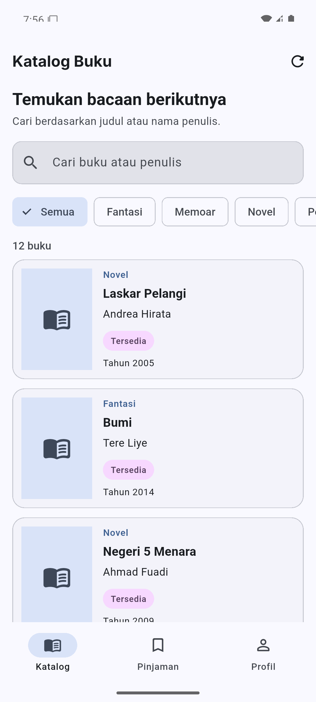
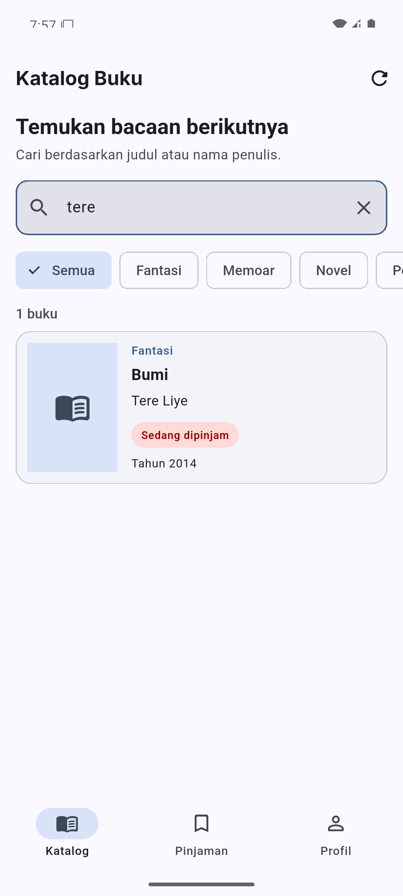
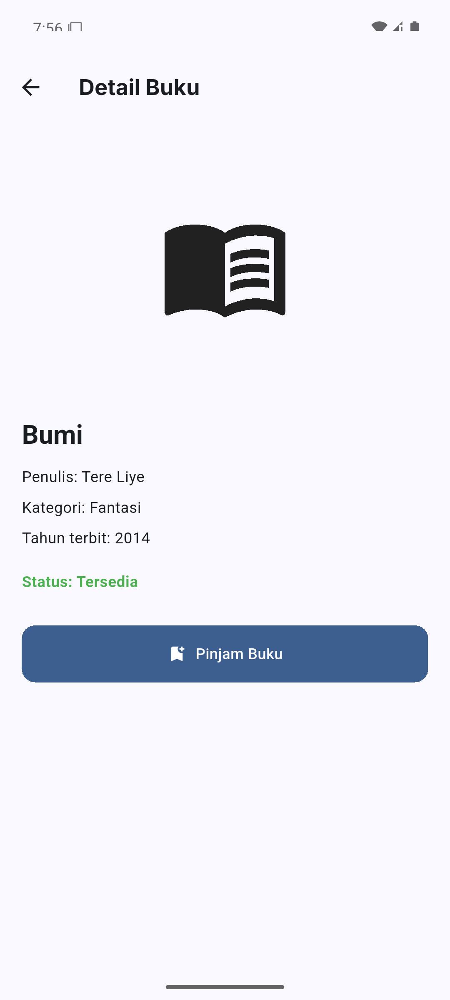
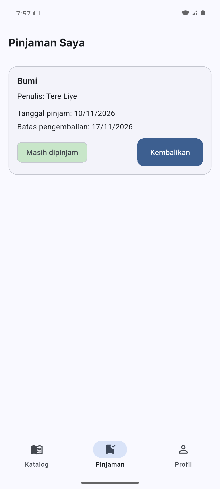
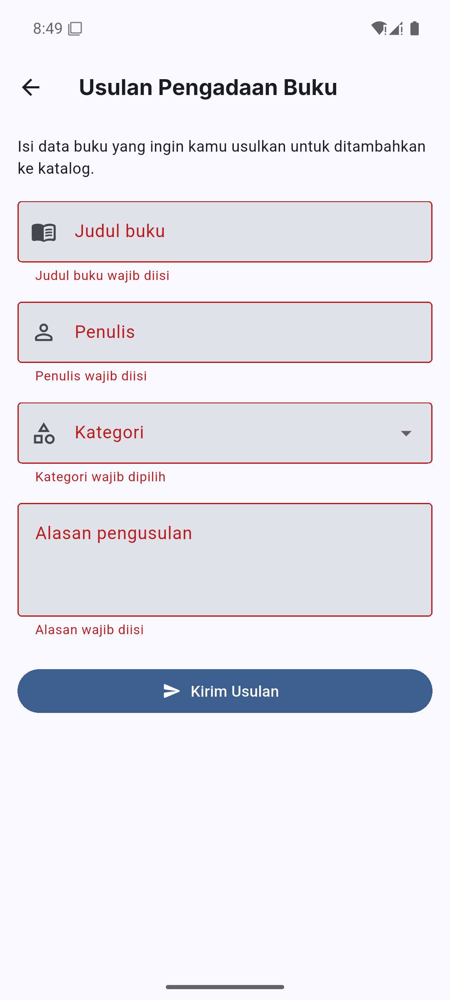
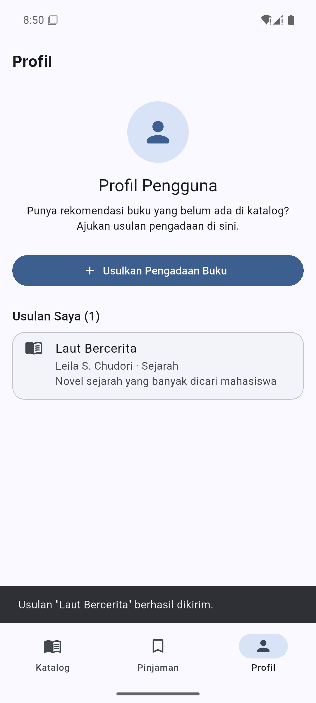
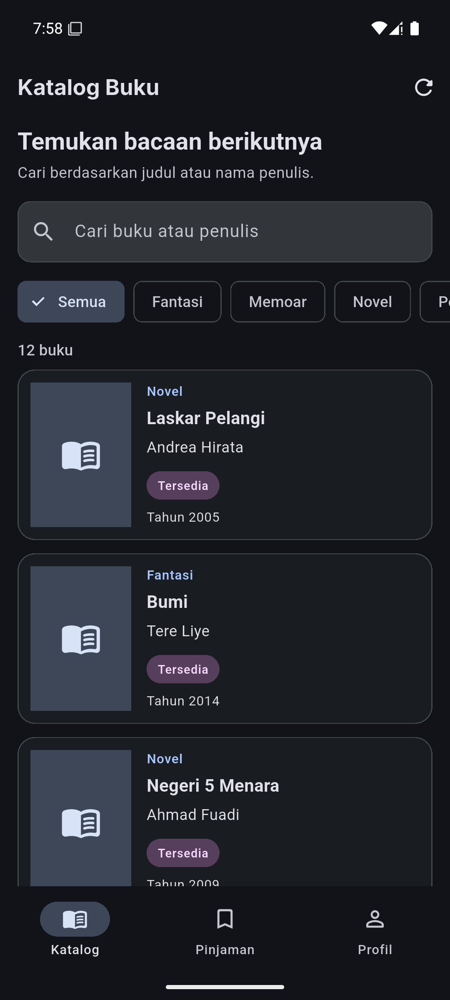
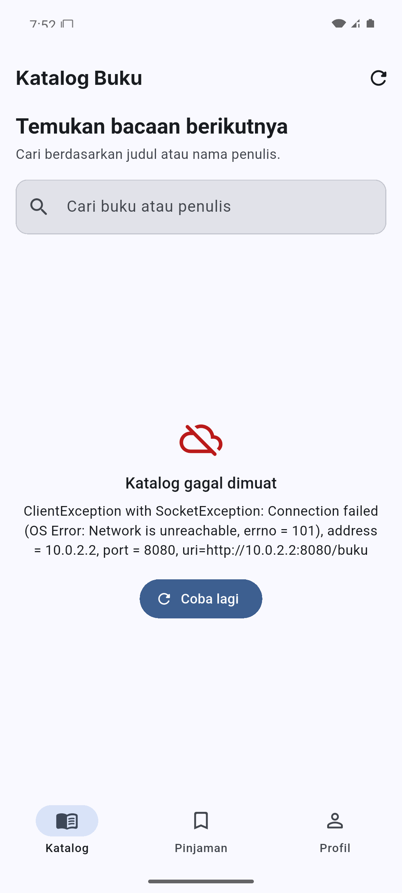
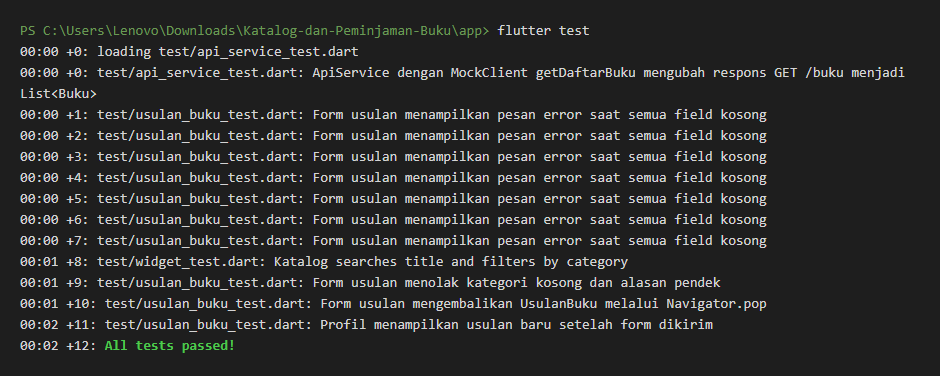

# 📚 Pustaka Mini

Aplikasi katalog dan peminjaman buku perpustakaan prodi berbasis Flutter, dilengkapi server REST API Dart (shelf). Dibuat untuk Proyek Tengah Semester (UTS) Pengembangan Aplikasi Bergerak.

## 👥 Kelompok

**Kelompok 04 · Proyek 7: Pustaka Mini (katalog dan peminjaman buku)**

| Nama | NIM | Tugas |
| --- | --- | --- |
| Faris | _isi NIM_ | Setup proyek, navigasi, tema, integrasi awal |
| Novi | _isi NIM_ | Model `Buku`, halaman Katalog, kartu buku, pencarian |
| Andra | _isi NIM_ | Server Dart shelf dan REST API |
| Alpi | _isi NIM_ | Halaman Detail Buku dan Peminjaman |
| Dio | _isi NIM_ | Form usulan pengadaan buku, `ApiService`, pengujian, dokumentasi |

## 🚀 Cara Menjalankan

Kebutuhan: Flutter SDK (sudah termasuk Dart) dan Android Emulator atau HP Android. Cek dengan `flutter doctor`.

### 1. Nyalakan server

```bash
cd server
dart pub get
dart run bin/server.dart
```

Server berjalan di `http://localhost:8080` dan memuat data dari `server/data/buku.json`. Port bisa diganti dengan environment variable `PORT`.

### 2. Jalankan aplikasi

Buka terminal baru:

```bash
cd app
flutter pub get
flutter run --dart-define=API_URL=http://10.0.2.2:8080
```

Alamat `API_URL` disesuaikan dengan perangkatnya:

| Perangkat | `API_URL` |
| --- | --- |
| Android Emulator | `http://10.0.2.2:8080` |
| HP Android (satu Wi-Fi dengan laptop) | `http://<IP-laptop>:8080`, misalnya `http://192.168.1.10:8080` |
| Chrome / desktop | `http://127.0.0.1:8080` |

Tanpa `--dart-define`, aplikasi otomatis memakai `10.0.2.2:8080` di Android dan `127.0.0.1:8080` di platform lain ([api_service.dart:23](app/lib/services/api_service.dart#L23)).

### 3. Pemeriksaan kode

```bash
cd app
flutter analyze
flutter test

cd ../server
dart test
```

## 🌐 Endpoint API

| Method | Path | Hasil |
| --- | --- | --- |
| GET | `/buku` | Daftar seluruh buku (12 item) |
| GET | `/buku/<id>` | Satu buku berdasarkan `id` |
| GET | `/kategori` | Endpoint khas tema: daftar kategori buku |

Di aplikasi, semua request dipusatkan di `ApiService` ([api_service.dart](app/lib/services/api_service.dart)) yang memakai paket `http`:

| Method `ApiService` | Endpoint | Hasil |
| --- | --- | --- |
| `getDaftarBuku()` | `GET /buku` | `List<Buku>` |
| `getDetailBuku(id)` | `GET /buku/<id>` | `Buku` |
| `getKategori()` | `GET /kategori` | `List<String>` |

Parameter `client` bisa diisi `MockClient`, sehingga layanan API bisa diuji tanpa server sungguhan.

## 📱 Fitur

- **Katalog**: daftar buku dari server, pencarian judul atau penulis, filter kategori dengan `ChoiceChip`, serta keadaan memuat, gagal (dengan tombol *Coba lagi*), dan berhasil.
- **Detail Buku**: informasi lengkap buku dan tombol **Pinjam Buku**.
- **Pinjaman Saya**: daftar buku yang dipinjam, lengkap dengan tanggal pinjam dan batas pengembalian (pinjam + 7 hari).
- **Profil**: tombol **Usulkan Pengadaan Buku** dan daftar **Usulan Saya**.
- **Form usulan pengadaan buku**: field judul, penulis, kategori (dropdown), dan alasan. Semua wajib diisi; judul minimal 3 karakter dan alasan minimal 10 karakter. Form mengembalikan objek `UsulanBuku` ke Profil lewat `Navigator.pop`, lalu usulan langsung tampil di daftar disertai SnackBar.
- **Tema terang dan gelap** yang mengikuti pengaturan perangkat.

## 🧪 Pengujian

| File | Jenis | Yang diuji |
| --- | --- | --- |
| `test/usulan_buku_test.dart` | 4 widget test | Validasi field kosong, validasi kategori dan alasan, data kembali lewat `Navigator.pop`, usulan tampil di Profil |
| `test/widget_test.dart` | 1 widget test + 2 unit test | Pencarian dan filter kategori di Katalog, `fromJson`/`toJson` model `Buku` |
| `test/api_service_test.dart` | 5 unit test dengan `MockClient` | `GET /buku`, `GET /buku/<id>`, `GET /kategori`, error HTTP 500, error HTTP 404 |

Hasil terakhir: `flutter test` 12 lulus, `flutter analyze` tanpa masalah.

## ✅ Tabel Pemenuhan Fitur

Semua path relatif terhadap folder `app/`, kecuali yang diawali `server/`.

### P01 & P02: Proyek dan aplikasi pertama

| Poin | File:baris | Keterangan |
| --- | --- | --- |
| Paket `id.ac.telkomuniversity` | `android/app/build.gradle.kts:19` | ✅ `id.ac.telkomuniversity.pustaka_mini` |
| Nama aplikasi di launcher sesuai tema | `android/app/src/main/AndroidManifest.xml:4` | ❌ Masih `pustaka_mini` |
| Berjalan di emulator Android, ≥ 4 tangkapan layar | `../screenshots/` | ✅ 7 tangkapan layar dari emulator Pixel 7 (Android 15) |
| `flutter analyze` bersih | — | ✅ No issues found |

### P03: Widget dasar, input, dan interaksi

| Poin | File:baris | Keterangan |
| --- | --- | --- |
| StatelessWidget dan StatefulWidget buatan sendiri, `setState` | `lib/widgets/kartu_buku.dart:7`, `lib/pages/halaman_katalog.dart:7`, `lib/pages/halaman_katalog.dart:39` | ✅ `KartuBuku` (stateless), `HalamanKatalog` (stateful), `setState` saat pencarian berubah |
| TextField dengan `TextEditingController` yang di-`dispose` | `lib/pages/halaman_katalog.dart:18`, `lib/pages/halaman_katalog.dart:31` | ✅ Kolom pencarian. Form usulan juga: `lib/pages/halaman_usulan_buku.dart:24-34` |
| Minimal dua jenis tombol Material 3 | `lib/pages/halaman_profil.dart:67`, `lib/pages/halaman_katalog.dart:61` | ✅ `FilledButton` dan `IconButton` |
| ChoiceChip / FilterChip / SegmentedButton | `lib/pages/halaman_katalog.dart:194` | ✅ `ChoiceChip` filter kategori |
| SnackBar | `lib/pages/halaman_detail_buku.dart:93` | ✅ Konfirmasi peminjaman. Juga saat usulan terkirim di Profil |

### P04: Model, layout, dan navigasi bawah

| Poin | File:baris | Keterangan |
| --- | --- | --- |
| Model ≥ 6 field, termasuk `DateTime` dan `bool` | `lib/models/buku.dart:1` | ✅ 8 field: `id`, `judul`, `penulis`, `kategori`, `tahun`, `tersedia` (bool), `tanggalMasuk` (DateTime), `sampul` |
| Kartu buatan sendiri dengan Row, Column, Expanded, Stack | `lib/widgets/kartu_buku.dart:41` | ✅ `Row` :41, `Stack` :47, `Expanded` :67, `Column` :68 |
| `ListView.builder` | `lib/pages/halaman_katalog.dart:172` | ✅ Daftar katalog. Juga di `lib/pages/halaman_pinjaman.dart:82` |
| NavigationBar ≥ 3 tab + IndexedStack | `lib/pages/halaman_utama.dart:27` | ✅ Tab Katalog, Pinjaman, Profil |

### P05: Banyak halaman, async, debugging, dan test

| Poin | File:baris | Keterangan |
| --- | --- | --- |
| Halaman detail menerima objek lewat konstruktor | `lib/widgets/kartu_buku.dart:30`, `lib/pages/halaman_detail_buku.dart:7` | ✅ `Navigator.push` ke `HalamanDetailBuku(buku: buku)` |
| Form tambah mengembalikan data lewat `Navigator.pop(context, data)` | `lib/pages/halaman_usulan_buku.dart:69`, `lib/pages/halaman_profil.dart:17` | ✅ Diterima dengan `await` dan langsung muncul di **Usulan Saya** |
| Cek `mounted` setelah `await` | `lib/pages/halaman_profil.dart:21` | ✅ |
| ≥ 3 widget test, `flutter test` lulus | `test/usulan_buku_test.dart:34` | ✅ 5 widget test, total 12 test lulus |

### P06: Tema, font, dan ikon

| Poin | File:baris | Keterangan |
| --- | --- | --- |
| `ColorScheme.fromSeed` + `darkTheme` | `lib/theme/app_theme.dart:11`, `lib/main.dart:19` | ✅ Seed `0xFF17365D` (biru tua) |
| Warna dari `colorScheme`, maksimal 3 `Colors.xxx` | `lib/pages/halaman_detail_buku.dart:73`, `lib/pages/halaman_pinjaman.dart:130` | ❌ Ada 4 pemakaian `Colors.red`/`Colors.green` untuk warna status |
| Font kustom | `lib/theme/app_theme.dart:39` | ✅ `google_fonts` (Inter) |
| Ikon launcher sendiri | `pubspec.yaml:50` | ❌ Paket sudah ada, ikon belum dibuat |
| Gambar aset lokal di `pubspec.yaml` | `pubspec.yaml:64` | ❌ Belum ada |

### P07: Web service, HTTP, dan JSON

| Poin | File:baris | Keterangan |
| --- | --- | --- |
| Folder `server/` dengan shelf + shelf_router, ≥ 12 item JSON | `server/lib/server.dart`, `server/data/buku.json` | ✅ 12 buku |
| 3 endpoint GET (daftar, per `id`, khas tema) | `server/lib/server.dart:27`, `server/lib/server.dart:31`, `server/lib/server.dart:52` | ✅ `/buku`, `/buku/<id>`, `/kategori` |
| Paket `http` + `--dart-define=API_URL` | `lib/services/api_service.dart:4`, `lib/services/api_service.dart:24` | ✅ |
| `fromJson`/`toJson` termasuk konversi DateTime | `lib/models/buku.dart:22`, `lib/models/buku.dart:62` | ⚠️ Konversi `tanggalMasuk` sudah ada (:31, :69), tapi `buku.json` belum mengisi `tanggalMasuk` |
| FutureBuilder 3 keadaan (memuat, gagal + *Coba lagi*, berhasil) | `lib/pages/halaman_katalog.dart:107` | ✅ Memuat :110, gagal :114, tombol *Coba lagi* :264 |
| Test dengan `MockClient` | `test/api_service_test.dart:16` | ✅ 5 test |

### Fitur khas tema (Proyek 7)

| Poin | File:baris | Keterangan |
| --- | --- | --- |
| Pencarian judul/penulis dengan TextField | `lib/pages/halaman_katalog.dart:88` | ✅ |
| Tombol "Pinjam" di detail mengembalikan hasil ke halaman sebelumnya | `lib/pages/halaman_detail_buku.dart:102` | ⚠️ Kembali dengan `Navigator.pop(context)`, belum membawa hasil |
| Pinjaman Saya menampilkan tanggal kembali (pinjam + 7 hari) | `lib/services/peminjaman_service.dart:32`, `lib/pages/halaman_pinjaman.dart:116` | ✅ |
| Endpoint khas `GET /kategori` | `server/lib/server.dart:52` | ✅ |
| Form tambah: judul, penulis, kategori, alasan | `lib/pages/halaman_usulan_buku.dart:79` | ✅ Kategori berupa dropdown (:116) |

## 📸 Tangkapan Layar

Diambil dari Android Emulator (Pixel 7, Android 15).

| Katalog | Pencarian | Detail | Pinjaman Saya |
| --- | --- | --- | --- |
|  |  |  |  |

| Validasi form usulan | Usulan di Profil | Dark mode | Gagal memuat + Coba lagi |
| --- | --- | --- | --- |
|  |  |  |  |

Output `flutter test`:



## 📂 Struktur Repository

```text
Katalog-dan-Peminjaman-Buku/
├── app/                      # Aplikasi Flutter
│   ├── lib/
│   │   ├── main.dart
│   │   ├── models/           # buku, peminjaman, usulan_buku
│   │   ├── pages/            # utama, katalog, detail, pinjaman, profil, usulan
│   │   ├── services/         # api_service, buku_service, peminjaman_service
│   │   ├── theme/            # app_theme
│   │   └── widgets/          # kartu_buku
│   ├── test/                 # widget test + test MockClient
│   └── pubspec.yaml
├── server/                   # API Dart (shelf)
│   ├── bin/server.dart
│   ├── lib/server.dart
│   └── data/buku.json        # 12 buku
├── screenshots/
└── README.md
```
